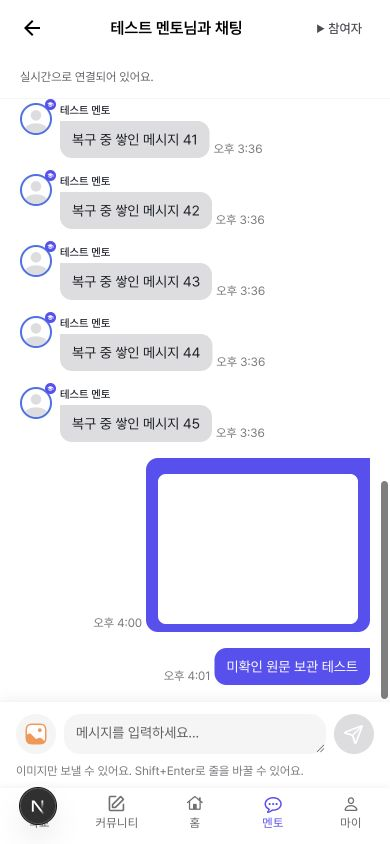

# 채팅 시스템

채팅은 기존 서버의 REST API와 STOMP 연결을 사용합니다. REST API는 대화 기록을 조회하고 읽음 상태를 변경합니다. STOMP는 연결이 열린 동안 새 메시지를 주고받는 통신 규칙입니다. 서버의 요청 경로와 데이터 형식은 유지합니다.

## 메시지를 관리하는 곳

`apps/web/src/lib/chat/ChatSession.ts`가 열린 채팅방의 대화 기록을 관리합니다. 기록 조회 응답과 실시간 수신은 모두 이곳에서 합칩니다. 화면이 별도의 메시지 배열을 만들어 서버 응답으로 덮어쓰지 않습니다.

메시지에 서버가 부여한 양수 ID가 있으면 같은 ID를 한 번만 표시합니다. ID가 없으면 작성자와 작성 시각과 본문 및 첨부 정보를 비교합니다. ID 없는 메시지의 해시값만 비교하면 다른 메시지를 하나로 합칠 수 있으므로 전체 정보를 비교합니다.

`stompTransport.ts`는 연결과 구독 및 발행을 담당합니다. 화면의 스크롤과 입력값은 알지 못합니다. 연결을 다시 열 때마다 공통 인증 함수에서 최신 토큰을 가져옵니다. HTTP 요청과 인증 초기화도 같은 토큰 갱신 요청을 공유합니다.

`useChatSession.ts`는 방이 열릴 때 세션을 시작하고 닫힐 때 정리합니다. `useChatScroll.ts`는 화면 위치만 관리합니다. 입력창은 작성 중인 문장과 선택한 이미지를 관리합니다.

## 연결이 끊겼다가 돌아올 때

연결이 끊기면 작성 중인 문장과 선택한 이미지를 유지합니다. 전송 버튼은 연결이 돌아올 때까지 잠그지만 문장은 계속 작성할 수 있습니다.

다시 연결하면 최신 기록부터 조회합니다. 마지막으로 조회를 마친 기록과 겹칠 때까지 다음 페이지도 확인합니다. 연결이 끊긴 동안 한 페이지보다 많은 메시지가 쌓여도 최신 한 페이지만 읽고 끝내지 않습니다. 실시간 수신만으로는 중간 기록이 이어졌다고 판단하지 않습니다.

사용자가 이전 대화를 여는 페이지 번호는 이 복구 조회와 별도로 관리합니다. 기록을 합칠 때 중복 메시지를 제거합니다. 이전 기록을 추가하는 동안 화면에서 보던 메시지의 위치를 유지합니다.

## 전송 확인과 실패

소켓의 발행 함수가 반환되어도 서버 저장 완료를 뜻하지는 않습니다. 발행한 메시지는 먼저 전송 대기 항목에 보관합니다. 서버 ID가 있는 새 자기 메시지를 수신하면 같은 본문 또는 이미지 URL에 해당하는 대기 항목을 순서대로 정리합니다. 중복 수신은 다음 대기 항목을 정리하는 근거로 사용하지 않습니다.

15초 안에 해당 수신을 확인하지 못하면 전송 여부를 확인해야 하는 상태로 표시합니다. 원문과 이미지 URL은 유지합니다. 같은 로그인 상태에서 다른 방에 갔다 돌아와도 확인하지 못한 항목을 다시 볼 수 있습니다. 이 보관은 메모리에서 이루어집니다. 페이지를 새로고침하거나 로그아웃하면 없어집니다.

메시지를 자동으로 다시 보내지는 않습니다. 현재 서버 요청에는 클라이언트가 만든 메시지 ID가 없어서 재전송한 요청과 새 요청을 서버가 구별한다는 보장이 없습니다. 확인되지 않은 항목에서는 기록을 다시 확인하거나 대기 표시만 지울 수 있습니다. 대기 표시를 지워도 서버의 메시지는 삭제되지 않습니다.

동일 계정의 다른 기기에서 같은 문장을 보내면 수신과 대기 항목의 정확한 대응은 보장할 수 없습니다. 서버가 클라이언트 메시지 ID를 받아 그대로 반환하도록 확장하면 이 제한을 해소할 수 있습니다. 현재 화면은 별도의 서버 저장 완료 표시를 제공하지 않습니다.

발행하기 전에 연결이 끊겼거나 이미지 업로드가 실패하면 입력창을 비우지 않습니다. 요청 진행 중에는 입력과 선택을 잠가 이전 요청의 완료가 새 입력을 지우지 않도록 합니다. 한글을 조합하는 중에는 Enter로 전송하지 않습니다.

## 이미지와 파일

선택한 이미지는 업로드 전에 미리 볼 수 있습니다. 미리보기용 임시 URL은 파일을 제거하거나 화면을 닫을 때 해제합니다. 이미지를 업로드한 뒤에도 원래 방과 사용자 세션이 유효한지 확인하고 발행합니다. 이전 방의 늦은 업로드 결과가 다른 방에서 발행되지 않습니다.

수신 이미지를 불러오지 못하면 최대 세 번 시도한 뒤 오류와 수동 재시도를 표시합니다. 일반 파일의 수신 표시와 다운로드는 유지합니다. 일반 파일을 보내는 서버 계약은 이 저장소에서 확인되지 않아 보내기 기능은 제공하지 않습니다. 잘못된 게시글 신고를 보내던 채팅 신고 버튼과 작동하지 않던 알림 설정도 제공하지 않습니다.

## 읽음과 사용자 격리

화면이 표시 중이고 대화의 하단을 보고 있을 때 읽음 요청을 보냅니다. 연속 수신은 요청 하나로 모읍니다. 읽음 요청 중 새 메시지가 들어오면 완료 후 다시 반영합니다. 실패하면 재시도 안내를 표시합니다.

방 목록과 상대 정보 및 미확인 전송 항목의 조회 키에는 로그인한 사용자 ID가 포함됩니다. 로그아웃이나 인증 실패 때 채팅 캐시를 제거합니다. 정리 중인 이전 화면이 제거된 캐시에 원문을 다시 쓰지 못하도록 현재 사용자도 확인합니다.

방이 바뀌거나 화면이 닫히면 진행 중인 요청을 취소합니다. 취소를 지원하지 않는 작업도 시작한 세대를 비교해 늦은 결과를 무시합니다. 기록 조회와 읽음 요청에서 403 또는 404를 받으면 연결을 종료하고 대화를 숨기며 전송을 막습니다. 상대 정보 조회에서 같은 응답을 받은 경우에도 대화를 숨깁니다.

## 검증

Node.js 22와 pnpm 9에서 다음 명령을 실행합니다. `ci:check`에는 채팅 테스트가 포함됩니다.

```sh
pnpm --filter @solid-connect/web run test:chat
pnpm --filter @solid-connect/web run typecheck
pnpm --filter @solid-connect/web run ci:check
```

테스트는 실제 서버 없이 제어 가능한 연결과 응답을 사용합니다. 초기 조회와 수신의 순서 역전과 여러 페이지의 재연결 복구 및 중복 수신을 확인합니다. 전송 실패와 늦은 업로드 및 방 전환과 읽음 요청을 확인합니다. 로그인 갱신 중 입력 유지와 로그아웃 뒤 데이터 제거도 확인합니다.

브라우저 검증은 실제 운영 메시지를 만들지 않는 로컬 서버에서 수행합니다. 실제 서비스의 두 계정 간 전달과 서버 저장 및 운영 환경의 읽음 집계는 별도 연동 검증이 필요합니다.

### 2026년 10월 27일 로컬 확인 결과

Node.js 22.20.0에서 웹 앱의 린트와 타입 검사 및 회귀 테스트 101개가 통과했습니다. 로컬 가짜 API를 사용하는 프로덕션 빌드도 통과했습니다. 브라우저는 로컬 가짜 서버와 실제 SockJS 클라이언트를 연결해 확인했습니다.

| 확인한 흐름 | 관찰한 결과 |
| --- | --- |
| 목록에서 방에 들어가 텍스트 전송 | 수신한 메시지가 한 번 표시되고 입력창이 비워짐 |
| 연결 중단 후 메시지 45개 누적 | 기존 기록과 합친 65개의 ID가 중복과 빈 구간 없이 이어짐 |
| 연결 중단 중 문장 작성 | 초안은 유지되고 전송 버튼은 잠김. 연결 복구 뒤 같은 초안이 남음 |
| 이미지 업로드 실패 후 재시도 | 선택 파일과 작성 중인 문장이 남음. 재시도 뒤 이미지가 한 번 표시됨 |
| 이전 기록 추가 | 표시된 메시지가 21개에서 40개로 늘어도 기준 메시지의 화면 위치는 167px로 유지됨 |
| 미확인 전송 후 방 이동과 복귀 | 다른 방에 원문이 나타나지 않음. 원래 방에 돌아오면 대기 항목이 남고 자동 재발행은 없음 |
| 목록 요청 실패 후 재시도 | 빈 목록 대신 오류를 표시함. 재시도 뒤 두 채팅방이 다시 표시됨 |
| 너비 390px 화면 | 문서 너비도 390px로 유지됨. 입력창이 하단 탐색 영역 위에 표시됨 |


